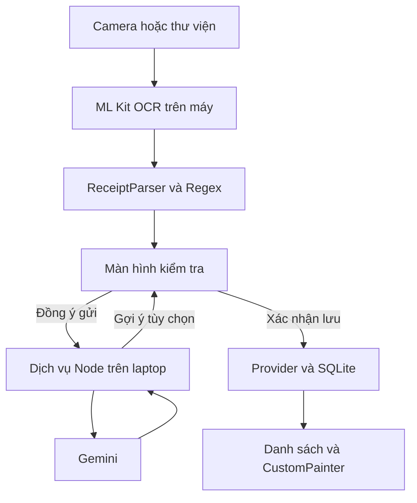

# ExpenseMate 1.2.1

**Mini-Project 3: Receipt OCR & Expense Tracker** — Flutter, Dart, ML Kit, Regex,
Provider, SQLite, CustomPainter; Gemini hỗ trợ danh mục, thông tin hóa đơn và nhận xét chi tiêu.

Bản 1.1.0 bổ sung hai luồng AI, thiết kế lại bốn tab, thống kê tuần/tháng, mục tiêu
chi tháng, lọc lịch sử, xuất CSV và cảnh báo khoản chi tương tự.
Xem **docs/11_TEST_1_1_0.md** để cập nhật và kiểm tra từng chức năng.
Các PDF/HTML báo cáo 1.0 trong gói là bản nháp cũ; cần cập nhật nội dung và ảnh
điện thoại của 1.1.0 trước khi nộp. Không xem chúng là bằng chứng nghiệm thu bản mới.

## Chạy nhanh trên Windows + Android

Đã có Flutter stable, Android SDK/NDK và điện thoại USB được cấp quyền:

```powershell
.\01_Setup.cmd
.\Start-App.cmd
```

AI là tùy chọn. Cài Node.js LTS 22 trở lên từ https://nodejs.org/ rồi mở terminal thứ hai:

```powershell
.\Start-AI.cmd
```

Nhập Gemini API key tại lời nhắc ẩn trên laptop. Dịch vụ chỉ nghe `127.0.0.1:8787`;
script tạo `adb reverse` qua USB. Vào app → Cài đặt → Kết nối Gemini, nhập URL
`http://127.0.0.1:8787` và **mã ghép nối** từ terminal, không nhập API key vào app.
Bấm gợi ý, xem nội dung sắp gửi, đồng ý, đọc giải thích rồi chọn Áp dụng.
Không có mạng/laptop/USB vẫn dùng OCR, SQLite và biểu đồ; phân loại chọn thủ công.
Nếu cần, đổi model bằng `$env:GEMINI_MODEL = "TEN_MODEL_KHA_DUNG"` trước Start-AI.

## Cập nhật bằng một lệnh (quy trình hiện hành)

Tải ZIP mới vào Projects, dừng app và AI, rồi chạy lệnh cố định bên dưới.
Không giải nén hoặc chép tay. Lệnh dùng bộ tìm ZIP đã có từ bản 1.0.2:

```powershell
powershell.exe -NoProfile -ExecutionPolicy Bypass -File "$env:USERPROFILE\Projects\ExpenseMate_Starter_v0.1.0\expense_mate\scripts\find-update.ps1"
```

Script chọn phiên bản cao nhất trong ZIP, kiểm tra, sao lưu source cũ và thay các tệp mã nguồn thuộc gói.
Tệp cũ thuộc manifest trước nhưng đã bỏ khỏi manifest mới được sao lưu rồi gỡ khỏi bản chạy.
Tệp riêng không do gói quản lý và tiện ích Manager đã cài được giữ. Không xóa database hoặc khóa ký.
Lỗi setup/analyze/test sẽ khôi phục source. ZIP thành công được chuyển vào processed.
Chạy app từ thư mục dự án cũ sau khi cập nhật; tên thư mục Starter không phải phiên bản đang chạy.

## Cách giải nén thủ công dự phòng

Đọc **BAT_DAU_CAP_NHAT.md** ở ngoài thư mục `expense_mate` trong ZIP cập nhật.
Dừng lượt chạy cũ bằng Ctrl+C, giải nén bản cập nhật vào thư mục riêng rồi chạy
`Update-ExpenseMate.cmd` ở bản vừa giải nén. Chọn thư mục dự án cũ nếu được hỏi.
Updater kiểm tra phiên bản, SHA-256, sao lưu các tệp bị thay, giữ Android wrapper,
SDK path, khóa ký, cấu hình AI; chạy setup + analyze + test và tự khôi phục source nếu thất bại.
Không gỡ ứng dụng, xóa SQLite hoặc ghi đè khóa ký. Chữ `(1)`, `(2)` trong tên ZIP không quyết định phiên bản.
Từ 1.0, Start-App còn tìm ZIP mới nhất theo VERSION trong Projects hoặc Downloads hoặc expense_mate-updates, kiểm tra và cập nhật trước khi chạy; ZIP đã dùng được cất vào processed. Sau cập nhật tiếp tục chạy **thư mục dự án cũ**. Xem docs/04_CAP_NHAT_VA_CHAY.md.

## Các chức năng

- Giao diện tiếng Việt Material 3, sáng/tối có lưu lựa chọn, icon riêng.
- Camera hoặc chọn ảnh, ML Kit nhận diện chữ Latin trên thiết bị; khôi phục ảnh khi Android hủy Activity.
- Parser chuẩn hóa dấu, lấy tên cửa hàng/ngày/tổng tiền, bỏ qua tiền khách đưa/tiền thừa.
- Xem ảnh và sửa thông tin trước lưu; chọn ngày khi OCR không tìm được.
- Thêm/xem/sửa/xóa SQLite; tìm không dấu, lọc ngày và danh mục, xếp số tiền/ngày, xuất CSV danh sách đã lọc.
- Cảnh báo khi trùng tên chuẩn hóa, ngày và số tiền; người dùng quyết định vẫn lưu.
- Sao chép ảnh về vùng lưu bền của app. Xóa khoản chi dọn ảnh tương ứng.
- Dashboard tổng tháng/hôm nay/tuần, mục tiêu chi tháng có lưu trên thiết bị.
- CustomPainter vẽ donut và cột theo ngày, hoạt ảnh, chọn tuần/tháng, so sánh kỳ trước theo phạm vi ngày hiển thị.
- Gemini gợi ý một trong sáu danh mục; cần bấm áp dụng.
- Gemini tìm tên/ngày/tổng tiền từ văn bản OCR khó, kèm căn cứ. Không có căn cứ thì để trống; người dùng chọn từng trường, áp dụng rồi xác nhận lưu.
- Gemini nhận xét số liệu tổng hợp tuần/tháng; ứng dụng tính số tiền/tỷ lệ, AI chọn điểm cần chú ý và lời gợi ý. Không gửi từng giao dịch cho chức năng này.
- Màn hình kiểm tra có phóng to ảnh, trạng thái trường thiếu và chỉnh văn bản OCR.
- CSV UTF-8 có BOM, escape dấu nháy và vô hiệu tiền tố công thức trong trường văn bản.
- Xuất/nhập JSON có ảnh, chống nhập lặp cùng bản sao lưu; không xuất bí mật AI.

## Kiến trúc



| Thư mục | Trách nhiệm |
|---|---|
| lib/core | Danh mục, màu, định dạng tiền/ngày |
| lib/models | Expense và ánh xạ SQLite |
| lib/services | OCR, Regex parser, AI client, SQLite, ảnh, backup |
| lib/state | ExpenseStore, thông báo UI khi dữ liệu thay đổi |
| lib/screens | Tổng quan/lịch sử/thống kê/cài đặt, kiểm tra, AI, sao lưu |
| lib/widgets | Biểu đồ CustomPainter và hoạt ảnh |
| server | Node HTTP service, xác thực mã ghép nối, Gemini, kiểm thử giả lập |
| scripts | Cài/cập nhật/chạy/build/chụp ảnh/đóng gói |
| docs | Báo cáo, hướng dẫn, kịch bản, bằng chứng |

## Dữ liệu

SQLite `expense_mate.db`, bảng `expenses`: id, merchant, amount (VND nguyên), date,
category, note, image_path, raw_text. Bảng `restored_items` chỉ đánh dấu các mục
đã nhập từ backup. Giữ version DB = 1 và tạo bảng phụ bằng `IF NOT EXISTS` khi mở,
để không nâng/hạ version của bảng khoản chi hiện có.

Không đổi debug application ID `vn.edu.vku.expense_mate`. Release dùng hậu tố
`.release`, cài riêng để tránh xung đột chữ ký debug. Chuyển dữ liệu qua
Cài đặt → Sao lưu & chuyển dữ liệu. Backup thêm bản ghi; không ghi đè thay đổi đã có.
Giữ file backup và khóa ký riêng tư. Gỡ ứng dụng vẫn làm mất vùng dữ liệu của bản đó.

## Kiểm tra

```powershell
flutter analyze
flutter test
node --test server/server.test.mjs server/features.test.mjs
```

GitHub Actions sẵn workflow kiểm tra Flutter + Node khi đẩy lên repository.

Trạng thái kiểm tra 1.2.1:
- 34 kiểm thử Node với Gemini giả lập đạt, gồm timeout/network/quota/key/thinking và kiểm tra không lộ bí mật trong diagnostics.
- Kiểm tra trực tiếp Dart các lớp geometry/parser/models/điều kiện lưu và dữ liệu cũ–mới đạt; analyzer thư mục models sạch. Formatter và cú pháp/import toàn bộ Dart đạt.
- Có 44 test Flutter trong source. Chưa chạy Flutter analyzer/tests trọn bộ, build Android, thử UI điện thoại hoặc Gemini thật cho 1.2.1 trong môi trường đóng gói. Updater chạy analyzer/tests trên laptop và rollback nếu lỗi.
- Không bảo đảm key/quota/model/kết nối của tài khoản người dùng hoạt động cho đến khi chạy Kiểm tra Gemini thật. Các kết quả giả lập không thay thế nghiệm thu thật.

## APK và hồ sơ nộp

- `Build-Release.cmd`: tạo khóa riêng trên máy bạn, kiểm tra, build và xuất `release/app-release.apk`, SHA-256.
- `Capture-Evidence.cmd`: chụp lần lượt sáng/tối/review/charts/AI từ điện thoại thật.
- `docs/report.html`: bản 4 trang in PDF bằng Chrome/Edge sau điền thông tin, cập nhật ảnh và trạng thái nghiệm thu.
- `docs/BaoCao_KyThuat_DuThao.pdf`: PDF chuẩn bị nghiệm thu; chưa thay thế báo cáo cuối có bằng chứng mới.
- `docs/06_KICH_BAN_VIDEO_VA_BAO_VE.md`: video 2–3 phút, cách dẫn và trả lời.
- `Package-Submission.cmd`: tạo source ZIP để nộp, giữ pubspec.lock đã resolve và loại bí mật/build/cache.
- `docs/07_NOP_BAI_GITHUB.md`: GitHub công khai, Releases, link demo và báo cáo.

Chưa có repository/link công khai, video thật, APK release hay kết quả Gemini thật trong ZIP này.
Không ghi các mục đó là đã hoàn thành trước khi thực hiện trên máy/tài khoản của chủ dự án.

## Hạn chế

- Mục tiêu chi tháng là thiết lập chung lặp lại cho các tháng, không phải hệ thống nhiều ví/ngân sách theo từng tháng. JSON backup hiện sao lưu khoản chi và ảnh; chưa chuyển thiết lập mục tiêu/giao diện.

- Nhắm Android, chưa cấu hình iOS/web/Windows desktop. ML Kit plugin không hỗ trợ web.
- VND nguyên; Regex đọc dd/MM/yyyy hoặc dd-MM-yyyy, AI có thể đề xuất ngày ISO nếu có căn cứ. Hóa đơn mờ, nhiều cột, ngoại tệ hoặc lỗi OCR cần chỉnh tay.
- Giới hạn backup 64 MB; tổng ảnh khi xuất 40 MB, ảnh JPEG/PNG tối đa 12 MB mỗi ảnh khi nhập.
- Chưa có đồng bộ tài khoản. AI demo phụ thuộc laptop/USB; dùng độc lập cần dịch vụ HTTPS được triển khai.
- Che dữ liệu AI theo quy tắc chỉ là hỗ trợ; người dùng phải xem nội dung trước khi đồng ý gửi ra Google.

## Nguồn kỹ thuật

- Bài giảng tuần 7 trang 41–43; tuần 8 trang 41–43 do người dùng cung cấp.
- https://docs.flutter.dev/platform-integration/android/setup
- https://docs.flutter.dev/deployment/android
- https://pub.dev/packages/google_mlkit_text_recognition
- https://ai.google.dev/api/generate-content
- https://ai.google.dev/gemini-api/docs/structured-output

Thông tin sinh viên: điền trong báo cáo. Repository/video/APK URL: điền sau khi xuất bản bằng tài khoản của bạn.

## Mới trong 1.2.0 — chi tiết hóa đơn

Xem **docs/12_HOA_DON_SAN_PHAM_1_2_0.md**. Ba mục Hóa đơn / Sản phẩm / Đối chiếu; chỉnh từng dòng, kiểm tra phép tính, lưu JSON chi tiết cùng một khoản chi. OCR giữ vị trí dòng/cột và parser bảo thủ hơn; không lấy chữ nhiễu `9O.OOO` thành `9`. Tổng dương vẫn phải được kiểm tra, không đặt ngưỡng tiền nhỏ tùy tiện.

AI đọc ảnh chỉ hoạt động sau hộp đồng ý gửi ảnh đầy đủ đến Gemini. Không che tự động nội dung ảnh; không gửi ảnh khi chỉ mở màn hình hoặc chạy OCR. Định dạng JPEG/PNG tối đa 2 MB, timeout tối đa 55 giây ở client. Mọi sản phẩm AI/OCR cần đối chiếu; phần không chắc vẫn để trống. Không đảm bảo đọc mọi loại hóa đơn.

DB giữ version 1, thêm cột TEXT nullable `receipt_details` nếu chưa có; không xóa bảng hoặc bản ghi cũ. Backup mới giữ chi tiết; backup cũ vẫn nhập được. Để giữ chi tiết sản phẩm khi nhập, máy nhận cần 1.2.0 trở lên. CSV lịch sử vẫn một dòng cho mỗi khoản chi, không phải bảng từng sản phẩm.

## Sửa lỗi 1.2.1

Xem docs/13_SUA_LOI_AI_VA_LUU_1_2_1.md. Giữ Gemini, không cần tạo key hoặc chuyển nhà cung cấp. Sau cập nhật phải khởi động lại Start-AI.cmd, vào Kết nối Gemini bấm Kiểm tra Gemini thật. Chia sẻ mã lỗi/ID hiển thị nếu lỗi; không gửi key hoặc mã ghép nối. Dịch vụ sẵn sàng và Kiểm tra kết nối chỉ xác nhận laptop, không xác nhận Google đã trả lời.
