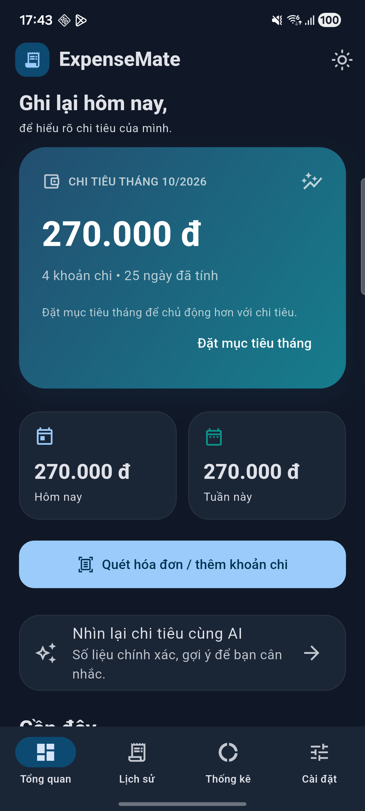
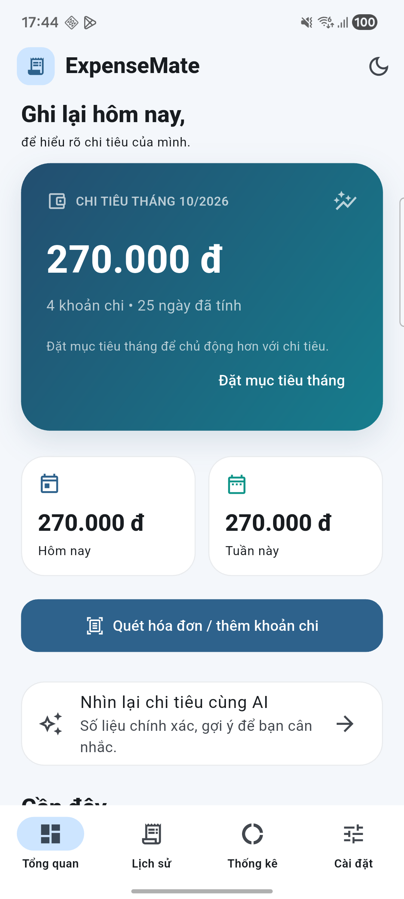

> Bản nháp bộ chức năng 1.0.0. Khi nộp 1.1.0 cần bổ sung hai AI mới, mục tiêu/CSV/thống kê tháng và ảnh thật; xem 11_TEST_1_1_0.md.

# ExpenseMate — Báo cáo kỹ thuật Mini-Project 3

Sinh viên/MSSV/Lớp: bổ sung. Phiên bản 1.0.0, chuẩn bị nghiệm thu.

## Bài toán và kiến trúc

Ứng dụng ghi chi tiêu từ hóa đơn cho sinh viên/người quản lý CLB: camera/chọn ảnh →
ML Kit OCR → Dart Regex → kiểm tra và sửa → Provider/SQLite/ảnh → CustomPainter.
Nhánh tùy chọn Gemini: người dùng đồng ý gửi một phần text → Node giữ API key →
Gemini trả JSON gợi ý danh mục → kiểm tra schema → người dùng quyết định áp dụng.
Sơ đồ chỉnh sửa: architecture.drawio.

## OCR và Regex

| Trường | Quy tắc |
|---|---|
| Tên cửa hàng | Dòng có chữ ở đầu hóa đơn, loại tiêu đề hóa đơn/địa chỉ/số điện thoại |
| Ngày | dd/MM/yyyy hoặc dd-MM-yyyy; kiểm tra ngày thực tế |
| VND | Số nguyên hoặc nhóm nghìn: 65000, 65.000, 65,000, 65 000 |
| Tổng | Ưu tiên tổng thanh toán/tổng cộng/grand total/amount due, tiếp theo tổng tiền/total |
| Loại trừ | Tạm tính, tiền khách đưa, tiền thừa, thuế, giảm giá |

Review luôn cho đối chiếu và sửa; thiếu ngày phải chọn, không tự suy đoán ngày hiện tại.

## Lưu trữ và biểu đồ

expenses: id, merchant, amount (INTEGER VND), date (ISO), category, note, image_path,
raw_text. Ảnh sao chép vào documents của ứng dụng. Bảng phụ restored_items chống
nhập lại cùng mục sao lưu. Donut dùng drawArc; cột theo tuần dùng drawRRect;
AnimationController tạo hoạt ảnh, tuần rỗng được xử lý tránh chia 0.

## Giao diện

Sau Capture-Evidence.cmd, ảnh nằm ở các đường dẫn dưới. Chưa có ảnh 1.0 ở lần đóng gói này.

## Kết quả và hạn chế

Bản nền 0.1 đã được chủ dự án chạy trên Android thật, analyzer sạch, 8 test đạt và
xác nhận chức năng cơ bản. Bản 1.0 có 9 test dịch vụ Node giả lập đạt, thêm 5 test
Flutter AI client chưa chạy trong môi trường tạo ZIP. Nghiệm thu Flutter/Windows,
Gemini thật, backup và APK release mới cần thực hiện theo 05_NGHIEM_THU.md.

OCR phụ thuộc chất lượng ảnh, parser chưa bao phủ ngoại tệ/tiền thập phân, AI local
cần USB/laptop/mạng; backup nhỏ, chưa đồng bộ tài khoản. Che thông tin cá nhân theo
quy tắc không thay thế việc người dùng xem trước nội dung gửi.

APK release ký riêng cài song song debug; chuyển dữ liệu qua backup, không gỡ bản cũ
trước khi đối chiếu. GitHub/video/APK URL điền sau khi xuất bản bằng tài khoản chủ dự án.
Báo cáo bám checklist slide; đối chiếu mẫu riêng của lớp nếu có.
